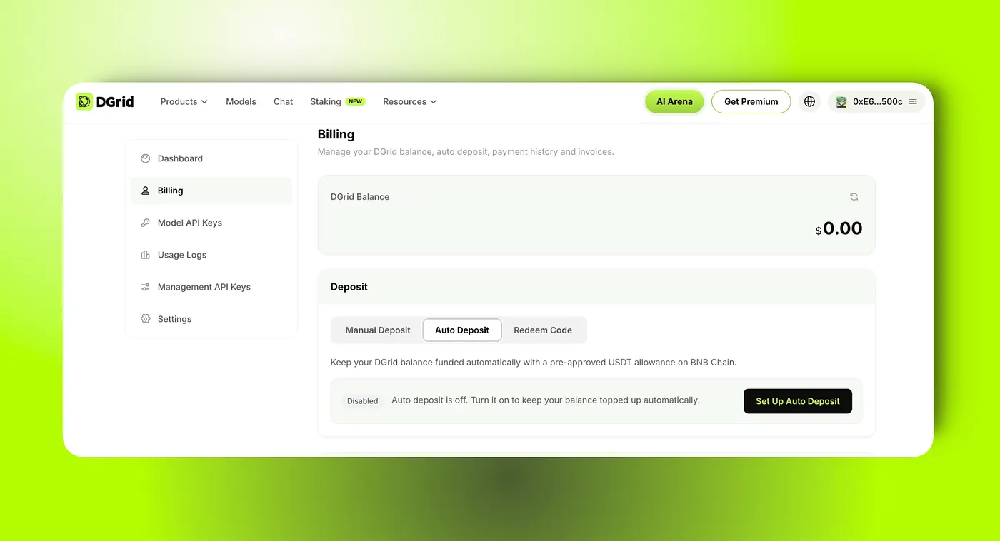
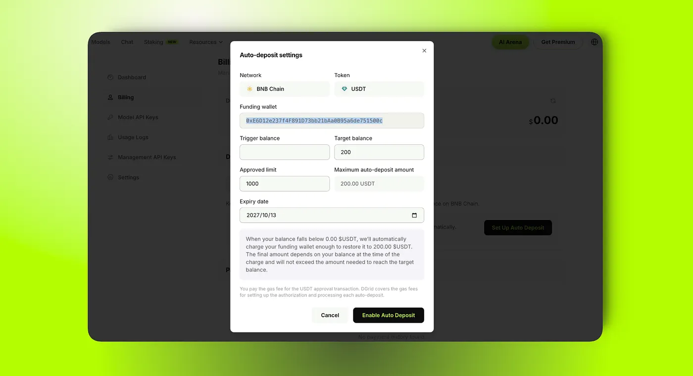
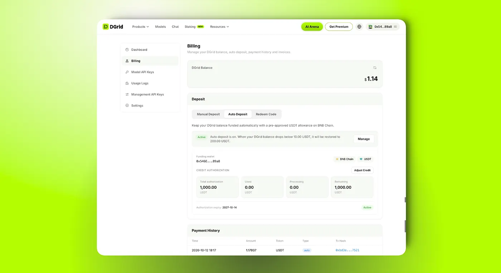

DGrid is powering more always-on work across long-running tasks, high-frequency service calls, and team-based workflows. As more users rely on DGrid for work that needs to keep moving, reliability is no longer just about compute capacity. It also depends on the operational details that keep every task connected from start to finish.

Balance is one of those small but critical details. When a balance runs low, users have to pause, check the account, add funds, and return to the task. In a continuous workflow, that simple account action can become a service interruption, a paused batch job, or a blocked team process.

To reduce that risk, **DGrid Auto Deposit** is now available.

## Built for more continuous AI workloads

**Auto Deposit turns balance management from a manual checkpoint into a configurable background rule.** Instead of waiting for a balance to run low and reacting in the middle of a workflow, users can define how DGrid should top up the account in advance.

Once enabled, **you can set a trigger balance, a target balance, an approved limit, and an expiry date.** When your DGrid Balance falls below the trigger balance, DGrid automatically tops it up from your authorized wallet, within the limits you set, helping the balance recover to the target level.

The goal is not to make deposits more complicated. It is to make balance management fit the rhythm of continuous tasks, service calls, and team workflows, so users can spend less time watching balances and more time building on DGrid.

## You stay in control

Auto Deposit only runs under the conditions you configure. The approved limit is not a prepayment and is not charged when Auto Deposit is enabled. Funds are only deducted when your DGrid Balance falls below the trigger balance and an auto-deposit is processed according to your rules.

You can adjust or turn off Auto Deposit at any time. This gives teams a more predictable way to support ongoing workloads while keeping spending within an explicit authorization range.

Gas fee note: You pay the gas fee for the USDT approval transaction. DGrid covers the gas fees for setting up the authorization and processing each auto-deposit.

## How to enable Auto Deposit

**Step 1: Go to Auto Deposit**

After logging in to DGrid, go to Billing > Deposit > Auto Deposit, then select Set Up Auto Deposit.

[https://dgrid.ai/billing](https://dgrid.ai/billing)

**Step 2: Configure your auto-deposit settings**

Enter your trigger balance, target balance, approved limit, and expiry date. The target balance must be higher than the trigger balance.

- Trigger balance: Auto Deposit is triggered when your DGrid Balance falls below this amount.
- Target balance: The balance level you want to restore after an auto-deposit.
- Approved limit: The maximum cumulative USDT amount DGrid can use during the authorization period.
- Expiry date: The date when the authorization expires.

The approved limit is simply the maximum amount DGrid may use within the authorization period. It is not charged immediately.

**Step 3: Authorize your wallet**

Select Enable Auto Deposit and follow the on-screen and wallet prompts to complete the authorization.

**Step 4: Check the Active status**

After authorization, return to the Auto Deposit page and wait for registration to complete. When the status shows Active, Auto Deposit is ready. From then on, DGrid will automatically process a top-up whenever your DGrid Balance falls below the trigger balance you set.

## Supporting a more reliable DGrid ecosystem

Auto Deposit is a practical step toward making DGrid more dependable for continuous AI workloads. By turning balance top-ups into a configurable background process, it helps reduce avoidable interruptions while keeping users in control of when funds are added and how much can be used.

As the DGrid ecosystem grows, users will increasingly rely on the network for more than individual requests. Long-running tasks, recurring service calls, automated processes, and team workflows all need reliable support over time. Features such as Auto Deposit help provide that operational foundation, allowing developers and teams to focus on the services they are building instead of repeatedly managing account balances.

This is part of DGrid’s broader effort to make decentralized AI infrastructure easier to use in real-world, ongoing operations. We will continue improving the tools that help users manage resources, maintain service continuity, and run workloads across the DGrid ecosystem with greater confidence.

To get started, go to **Billing > Deposit > Auto Deposit** and select **Set Up Auto Deposit**.

For more info, please check: [https://docs.dgrid.ai/ai-gateway/auto-deposit](https://docs.dgrid.ai/ai-gateway/auto-deposit)

## About DGrid AI

DGrid AI is a decentralized AI smart network dedicated to building an open, transparent, and community-driven decentralized AI network. By establishing a unified smart marketplace and scheduling layer, it provides developers and users with low-cost, verifiable, and trustless access to models and AI Agents.

[Website](https://dgrid.ai/) | [Docs](https://docs.dgrid.ai/) | [X](https://x.com/dgrid_ai) | [Telegram](https://t.me/dgrid_ai)
