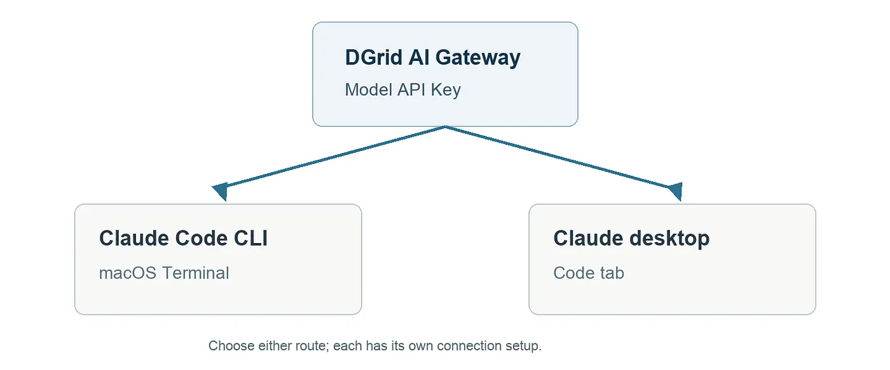
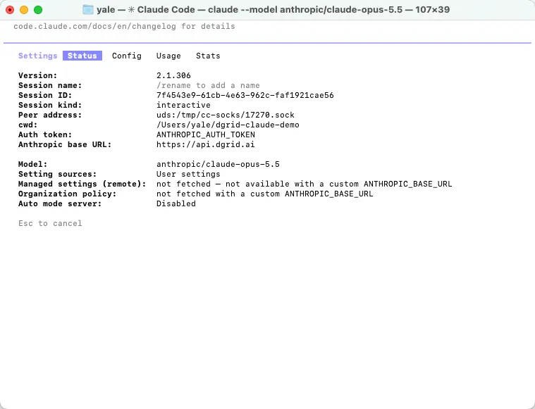
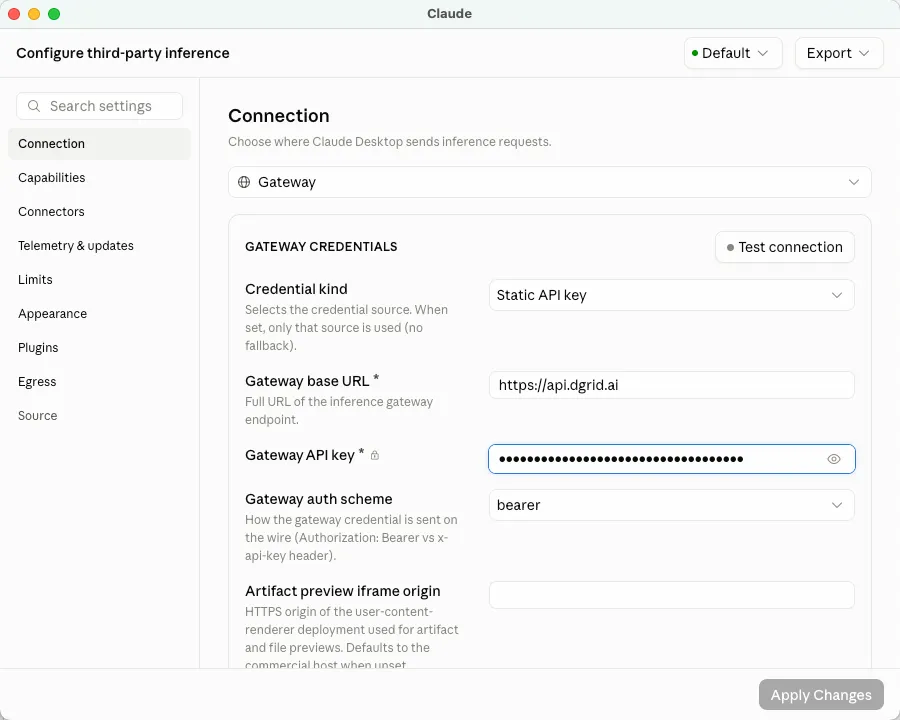

Connect Claude Code to DGrid with your DGrid API key, the gateway URL, and a Claude model available to your key. This guide covers macOS Terminal first, followed by an alternative setup in the Claude desktop app’s Code tab.

This walkthrough uses anthropic/claude-opus-5.5 as an example.



Two ways to connect Claude Code to DGrid

## Get the key

Sign in to [DGrid](https://dgrid.ai/), create a **Model API Key** on the [API Keys page](https://dgrid.ai/api-keys), and check that your account has credits and access to the model. Keep the key private. Use the base URL as shown; it does not need an API path appended.

Click ​**Create New Key**​, give the key a name, then create and copy it. Open DGrid’s model catalog and copy an available Claude model’s complete ID. Enter only [https://api.dgrid.ai](https://api.dgrid.ai/) as the base URL; omit both /v1 and /v1/messages.

Before continuing, check these requirements:

* Use macOS and Zsh for the Terminal commands in this article.
* A Model API Key is required for inference. An administrative Management API Key will not work here.
* Copy the model ID from DGrid’s catalog, including its provider prefix. If you choose a different model, replace the example ID throughout the setup.
* The desktop route can be completed independently of the CLI route.

## Route A: Terminal

On macOS, check claude — version first. If Claude Code is absent, install it with one method. The [native installer](https://code.claude.com/docs/en/setup#install-claude-code) is the shortest route:

```
curl -fsSL https://claude.ai/install.sh | bash
```

Open a new Terminal window and run claude — version to verify the installation. If the shell cannot locate the command, run export PATH=”\$HOME/.local/bin:\$PATH”, then try claude — version again. If the native installer cannot download successfully, use the npm route below. Choose one successful installation method before continuing.

### Alternative npm installation

For npm, first check that Node.js 22 or later and npm are installed:

```
node -v
npm -v
```

If necessary, install the current LTS release with the macOS installer from [Node.js](https://nodejs.org/en/download), then reopen Terminal. Install Claude Code under your user directory and check the launcher:

```
npm install -g @anthropic-ai/claude-code - prefix "$HOME/.local"
export PATH="$HOME/.local/bin:$PATH"
claude - version
```

This installation does not require sudo. To retain the PATH entry in future Zsh sessions, add the export line to \~/.zshrc.

### Configure and launch

In the Terminal where you will run Claude Code, set the gateway and enter the key privately:

```
export ANTHROPIC_BASE_URL="https://api.dgrid.ai"
unset ANTHROPIC_API_KEY
export ANTHROPIC_AUTH_TOKEN
read -rs "ANTHROPIC_AUTH_TOKEN?DGrid key (hidden): "
```

The key stays hidden as you paste it. These exports belong to the current shell session; in a new Terminal window, configure them again or use the project settings below.

After pasting the key and pressing Enter, use the same Terminal window to start Claude Code:

```
mkdir -p "$HOME/dgrid-claude-demo"
cd "$HOME/dgrid-claude-demo"
claude - model "anthropic/claude-opus-5.5"
```

If Claude Code asks you to trust the folder, confirm the path you just created. Inside Claude Code, run /status.

Confirm:

* Anthropic base URL: [https://api.dgrid.ai](https://api.dgrid.ai/)
* Auth token: ANTHROPIC\_AUTH\_TOKEN
* Model: anthropic/claude-opus-5.5, or the complete ID you selected

Press Esc to return to the chat. Send Reply with exactly: DGrid connection successful and wait for DGrid connection successful. DGrid’s request history provides a second place to confirm the request.



Claude Code status after connecting to DGrid

For a usage check, find the matching model and request time in DGrid’s request history. Look for a **Success** result. Token usage and charges vary with the request.

### Optional project settings

To reuse this connection in a project, first exclude .claude/settings.local.json in that project’s .gitignore. Then create or update the local settings file with the following fields:

```
{
 "env": {
 "ANTHROPIC_BASE_URL": "https://api.dgrid.ai",
 "ANTHROPIC_AUTH_TOKEN": "<your-dgrid-api-key>",
 "ANTHROPIC_API_KEY": ""
 },
 "model": "anthropic/claude-opus-5.5"
}
```

Replace the placeholder with your key and merge the fields into any existing configuration. The file contains a credential, so keep it private. From a new terminal, enter the project, launch claude, and confirm the effective connection with /status.

## Route B: Claude desktop

Desktop inference has its own connection settings. The exports used for the CLI do not configure this route.

Install the [Claude desktop app](https://claude.com/download). On macOS, enable Developer Mode from ​**Help → Troubleshooting**​, then open ​**Developer → Configure Third-Party Inference…**​.

In ​**Connection**​, use these settings:

* Inference provider: **Gateway**
* Credential kind: **Static API key**
* Gateway base URL: [https://api.dgrid.ai](https://api.dgrid.ai/)
* Gateway API key: your DGrid key
* Auth scheme: **bearer**

Apply the changes and reopen the app.



DGrid connection fields in Claude desktop

Leave **Artifact preview iframe origin** unchanged for this setup. You can use **Test connection** to inspect connectivity. If the Developer menu vanishes after applying the settings, enable Developer Mode again from the Help menu.

In ​**Code**​:

* start a new session and select **This computer** if an environment selector appears
* open the model picker and select anthropic/claude-opus-5.5, or your chosen available Claude model
* click **Choose a folder** and select dgrid-claude-demo; if you skipped the CLI route, create and select a new project folder

Send Reply with exactly: DGrid connection successful. Check that the response appears under the intended model.

## Common connection checks

* **Missing CLI command:** Run type -a claude. For the npm installation above, check PATH and try “\$HOME/.local/bin/claude” — version directly.
* **Wrong key or gateway:** Review the provider entries in \~/.claude/settings.json, .claude/settings.json, and .claude/settings.local.json. A settings file can override shell exports. Restart Claude Code after changing the relevant fields, then inspect /status.
* **Authentication or model failure:** Recheck the Model API Key, credits, model access, and complete model ID.
* **Desktop test failure:** Open the error details and inspect the URL, HTTP status, response, and probedModel when shown. A connection test can probe a different model from your chat selection.
* **Expected model is missing:** Revisit the desktop gateway settings and confirm that the connection was applied and that the key can access the model.

For screenshots, local settings, and error-specific fixes, read the [complete Claude Code integration tutorial](https://docs.dgrid.ai/ai-gateway/integrations/claude-code).


## About DGrid AI

DGrid AI is a decentralized AI smart network dedicated to building an open, transparent, and community-driven decentralized AI network. By establishing a unified smart marketplace and scheduling layer, it provides developers and users with low-cost, verifiable, and trustless access to models and AI Agents.

[Website](https://dgrid.ai/) | [Docs](https://docs.dgrid.ai/) | [X](https://x.com/dgrid_ai) | [Telegram](https://t.me/dgrid_ai)


