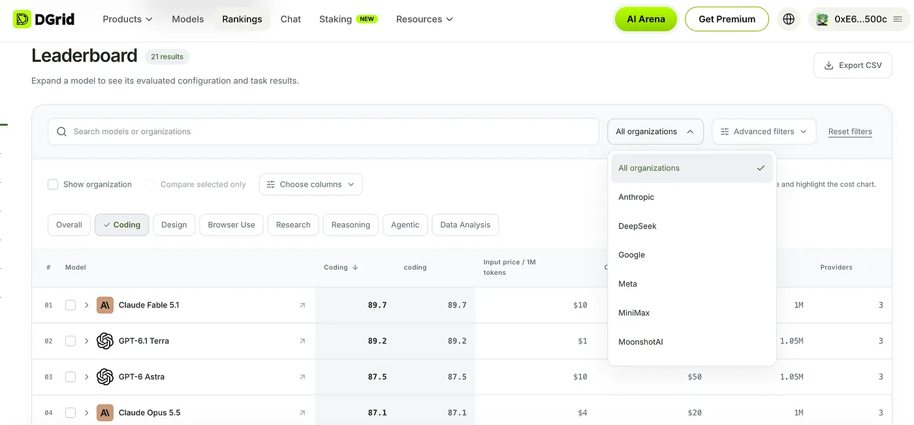
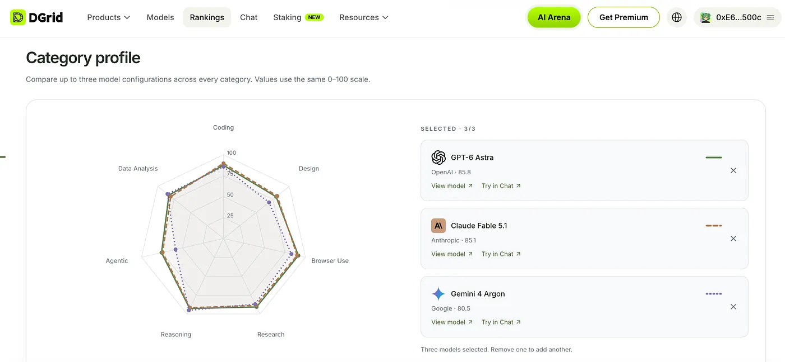
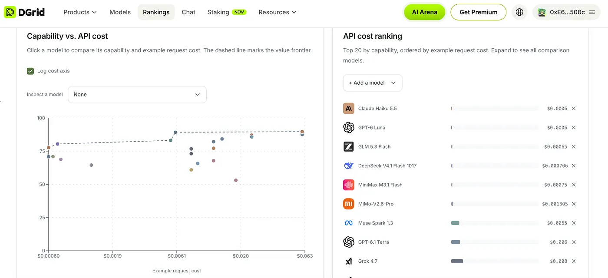
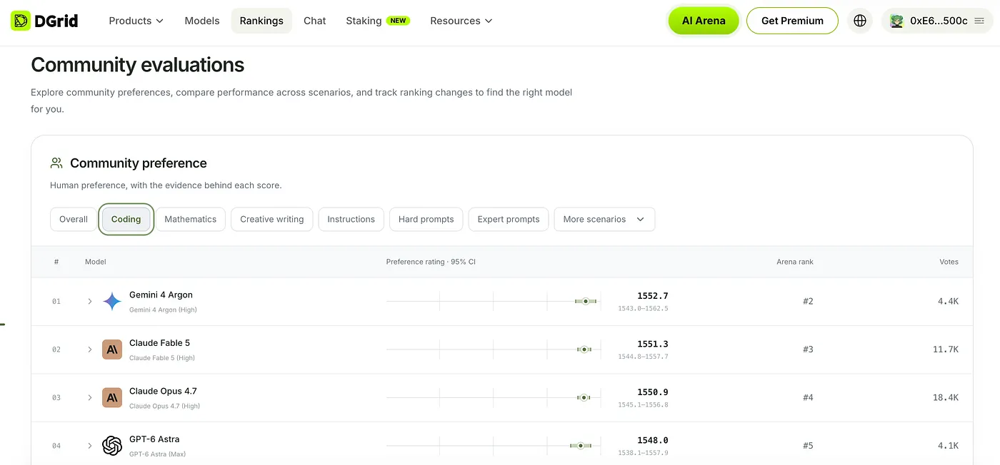

You may have faced this situation: you have a task you’d like AI to help with, but you’re not sure which model to use. Browse a model list and you’ll find some models near the top of the overall rankings, others at lower prices, and still others that perform especially well on specific tasks. They all have something to offer. But which one is right for your needs?

An overall ranking rarely tells the whole story. To make a choice, you may need to visit several sites to compare evaluations and prices, look at how models perform on specific tasks, and even try them one by one. The more models there are, the longer this takes. And when evaluation metrics differ, it can be hard to know which information matters most.

**DGrid Model Rankings is a searchable, filterable leaderboard designed to help you compare models across the dimensions that matter to your decision.** Search by model, organization, or task category, then explore differences in capability, cost, budget fit, and evaluation results.

DGrid believes there is no single model that is best for every situation. A useful ranking should do more than show who comes out on top: it should help people understand the capabilities, costs, and context behind the results. DGrid Model Rankings brings these perspectives together, so you can make a choice based on what you actually need.

## **Look beyond the overall score**

An overall ranking offers a helpful starting point, but different tasks call for different capabilities. The differences between candidate models may come down to performance in a particular category, API pricing, whether a model fits your budget, or how people respond to its answers.

DGrid Model Rankings offers six complementary ways to explore those differences.

**Performance & Cost Analysis**

View model capability scores alongside current DGrid API prices for a selected evaluation scope. Select a model to compare its capability with an example call cost, and see the cost-effectiveness frontier for the current view. The API cost ranking orders high-performing models, by example call cost. Example costs use 1,000 input tokens and 1,000 output tokens; actual charges depend on the provider you choose and your usage.

**Capability Profiles**

Select up to three model configurations and compare their scores across the same capability categories. Coding, Design, Browser Use, Research, Reasoning, Agentic, and Data Analysis are all scored on a 0–100 scale, making it easier to see the strengths behind an overall score.

**Category Leaders**

Explore the top three DGrid-supported models in each task category, evaluated within the same benchmark release. Start with the category most relevant to your work and find models worth comparing. A category-leading result reflects performance in that evaluation category; It does not mean a model is best for every task.

**Budget Selection**

Set an evaluation scope, total budget, input and output tokens per call, and expected number of calls. DGrid estimates total cost using your projected usage and current DGrid API prices, then filters for models that fit your budget. Estimates exclude cache discounts and additional reasoning tokens. Actual costs vary with usage and provider pricing.

**Benchmark Output Usage**

Set a minimum capability score and compare models by their average output tokens on evaluation tasks. These figures come from published averages per task and may include multi-turn Agent runs. They do not represent the length of a single API response or measure latency.

**Community Preference Evaluations**

Explore community preferences across different scenarios, along with evaluation evidence and ranking changes over time. Community preference reflects which answers people favor; it measures something different from an objective benchmark score. Read each result in the context of its model version, evaluation scope, and sample coverage.

Taken together, these perspectives are not meant to reduce every model to one answer for everyone. They show task performance, capability profiles, cost, and community signals, so you can decide which factors matter most for your goals and which differences deserve a closer look.

## Why DGrid built Model Rankings

Across DGrid, we’re building AI infra that help people discover, access, evaluate, and use AI models. The Model Marketplace brings a growing range of models together in one place, making them easier to explore. AI Gateway gives developers a unified way to access models. DClaw helps users deploy AI agents, while AI Arena invites people to compare model responses and contribute valuable preference signals.

Each product supports a different part of the journey: finding models, connecting to them, building with them, and understanding how people respond to their outputs. As this ecosystem expands, another question becomes increasingly important: **with so many models available, where should you start?** Which models are worth considering for your task, and how do their capabilities, costs, and evaluation results compare?

**We built DGrid Model Rankings to help answer that question.** It gives users a clearer way to navigate the growing model landscape and build a shortlist grounded in the factors that matter to them.

## Turn comparison into a practical choice

Imagine you’re choosing a model for a coding project with a clear budget. DGrid Model Rankings can turn what might otherwise be a scattered research process into a practical path from initial search to a shortlist.

**Start with the task.** Search for a model or organization, select the coding category, and review the category leaders from the same evaluation release. This gives you a set of DGrid-supported models worth a closer look.

​**Compare capabilities, not just overall scores**​. Select up to three candidates and compare their Coding scores alongside related capabilities such as Reasoning and Agentic. See which combination of strengths best fits your project.

**Weigh performance against your budget. ​**In Performance & Cost Analysis, review capability scores, current API prices, and example call costs for your selected evaluation scope. Then enter your expected call volume and token usage in Budget Selection to estimate which options fit your budget.

**Use other signals to shape your testing. ​**Review benchmark output usage and community preferences across scenarios to decide what you want to examine more closely. Then test your shortlist with your own prompts, data, and workflow, evaluating response quality, reliability, and actual cost.

The result is not a verdict that applies to everyone. It’s a shortlist shaped around your project, ready to be tested in your real workflow. DGrid Model Rankings helps shift time away from gathering scattered information and toward evaluating the options that are most relevant—so, every test has a clearer purpose.

## DGrid AI: Connecting models to real-world use

DGrid brings together tools to discover, evaluate, and put AI models to work. DGrid Model Rankings helps users understand how models differ across tasks, capabilities, and costs, so they can make a more informed choice for the work they want to do.

The goal is to make a growing model ecosystem easier to navigate—and help people connect the right AI capabilities with real needs.

We believe a growing model ecosystem should give people more possibilities, not make every choice harder.

**Explore DGrid Model Rankings:** [https://dgrid.ai/rankings](https://dgrid.ai/rankings)

## About DGrid AI

DGrid AI is a decentralized AI smart network dedicated to building an open, transparent, and community-driven decentralized AI network. By establishing a unified smart marketplace and scheduling layer, it provides developers and users with low-cost, verifiable, and trustless access to models and AI Agents.

[Website](https://dgrid.ai/) | [Docs](https://docs.dgrid.ai/) | [X](https://x.com/dgrid_ai) | [Telegram](https://t.me/dgrid_ai)

