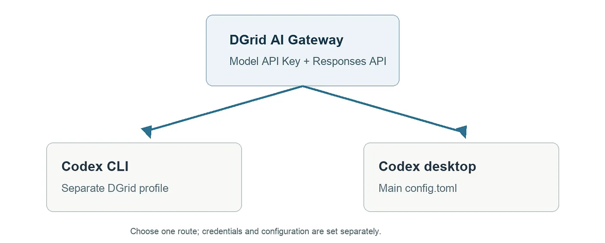
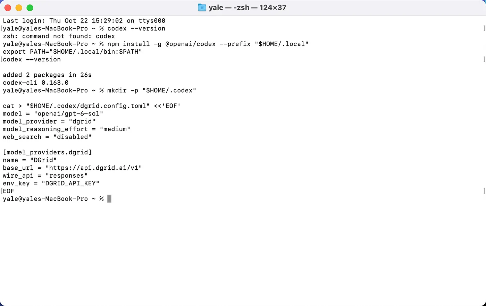
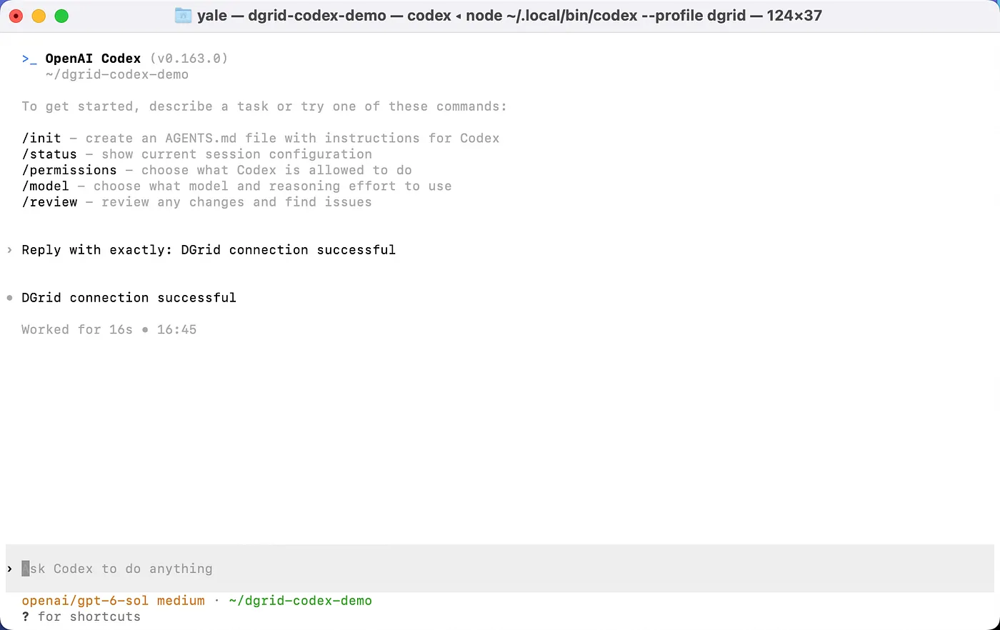
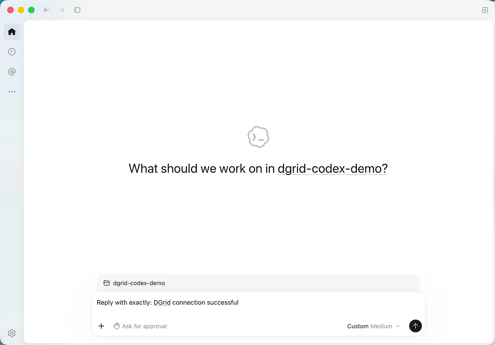
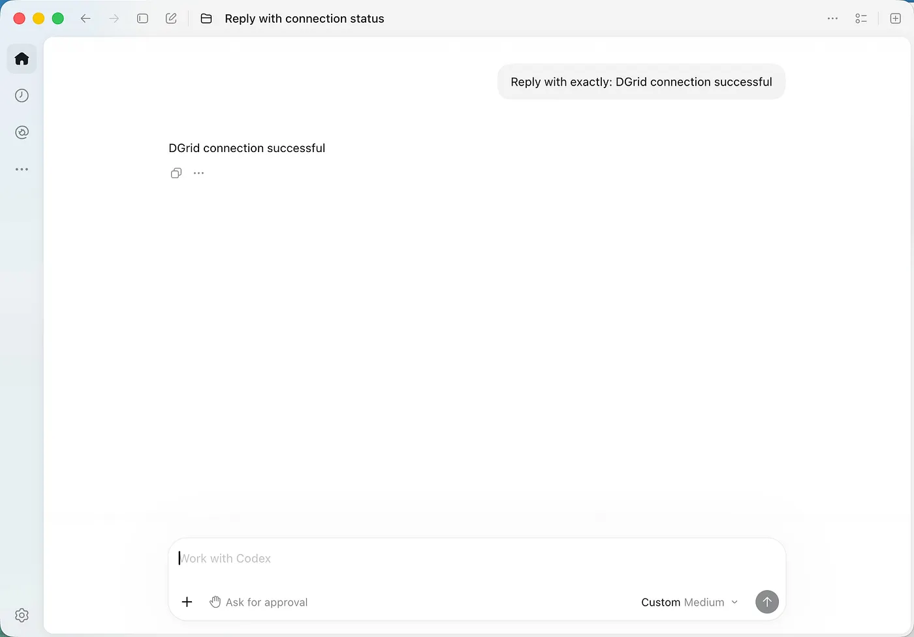
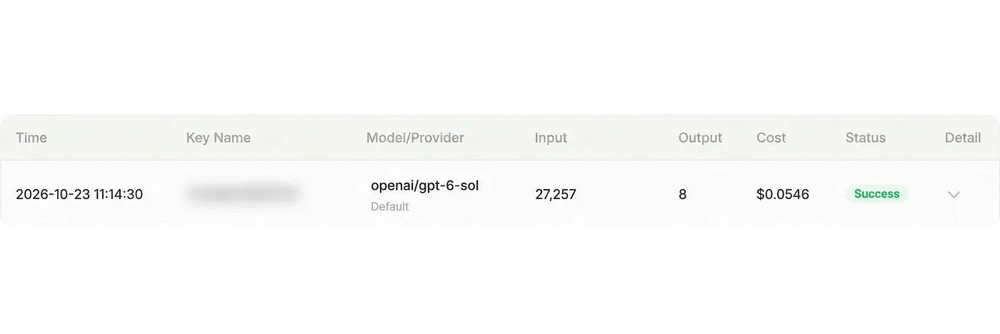

Connect Codex CLI or Codex in the desktop app to DGrid AI Gateway using a DGrid Model API Key and a model that supports the Responses API. This guide walks through both routes and verifies the first successful request. Choose either route; the CLI profile and desktop configuration are separate.

The examples use the model ID `openai/gpt-6-sol`. Use the complete ID shown in DGrid’s model catalog for your account. The base URL is `https://api.dgrid.ai/v1`, the wire API is `responses`, and the credential environment variable is `DGRID_API_KEY`.



Codex CLI and desktop can connect to DGrid through separate configurations

## Before you start

* A DGrid account with credits and access to a model that supports the Responses API.
* A DGrid ​**Model API Key**​. A Management API Key is for administration and cannot authenticate model requests.
* For the CLI install: Node.js and npm. The desktop app can be configured independently of the CLI.
* Preserve the complete model ID, including its `openai/` prefix. Keep the API key out of screenshots and shared files.

The CLI route uses a separate profile and only selects DGrid when launched with `--profile dgrid`. On macOS, the desktop app reads `~/.codex/config.toml` at startup; changing that file changes the default provider for clients that read it. If you need to preserve your existing desktop setup, use another computer for the desktop route.

## Route A: Codex CLI

### 1. Install Codex CLI

Install the current LTS version of Node.js for your operating system if needed; the standard installer includes npm. Open Terminal on macOS or PowerShell on Windows, then check:

```
node -v
npm -v
```

Install Codex from npm. Use the matching operating-system commands.

**macOS**

```
npm install -g @openai/codex --prefix "$HOME/.local"
export PATH="$HOME/.local/bin:$PATH"
codex --version
```

The PATH export applies to this terminal. Repeat it in a new terminal, or add it to your shell configuration.

**Windows PowerShell**

```
npm install -g @openai/codex
codex --version
```

If PowerShell blocks `npm.ps1`, run `npm.cmd` instead of `npm`. The separate profile-file format used below requires Codex CLI 0.134.0 or later.

### 2. Create the DGrid profile

Create `~/.codex/dgrid.config.toml` on macOS, or `%USERPROFILE%\.codex\dgrid.config.toml` on Windows. Add these settings, replacing the example model ID if needed:

```
model = "openai/gpt-6-sol"
model_provider = "dgrid"
model_reasoning_effort = "medium"
web_search = "disabled"

[model_providers.dgrid]
name = "DGrid"
base_url = "https://api.dgrid.ai/v1"
wire_api = "responses"
env_key = "DGRID_API_KEY"
```

On macOS, create and open the profile file with:

```
mkdir -p "$HOME/.codex"
touch "$HOME/.codex/dgrid.config.toml"
open -t "$HOME/.codex/dgrid.config.toml"
```

Save it as plain text using straight quotation marks. If the file already contains settings, edit matching values and avoid duplicate keys. `env_key` is the name of the environment variable; it does not store the API key.



Codex CLI installed and the DGrid profile created

### 3. Enter the API key

Set the key in the same terminal that will launch Codex.

**macOS Terminal with Zsh**

```
export DGRID_API_KEY
read -rs "DGRID_API_KEY?Paste your DGrid API key (hidden): "
```

Paste the key at the hidden prompt and press Enter. Wait for the terminal prompt to return.

**Windows PowerShell**

Run the first command, enter the key at the masked prompt, then run the remaining commands:

```
$dgridSecureKey = Read-Host "Paste your DGrid API key (hidden)" -AsSecureString
$env:DGRID_API_KEY = [System.Net.NetworkCredential]::new("", $dgridSecureKey).Password
Remove-Variable dgridSecureKey
```

The key is set only for this terminal session. Enter it again in a new terminal.

### 4. Launch Codex and verify the request

Create a demo folder and launch Codex with the DGrid profile.

**macOS**

```
mkdir -p "$HOME/dgrid-codex-demo"
cd "$HOME/dgrid-codex-demo"
codex --profile dgrid
```

**Windows PowerShell**

```
New-Item -ItemType Directory -Force "$HOME/dgrid-codex-demo" | Out-Null
Set-Location "$HOME/dgrid-codex-demo"
codex --profile dgrid
```

If Codex asks whether you trust the folder, confirm the demo folder you created. Check that the selected model is `openai/gpt-6-sol`; use `/status` to inspect the session. Send:

```
Reply with exactly: DGrid connection successful
```

The expected response is:

```
DGrid connection successful
```




Codex CLI returns the expected response using DGrid

If startup displays `Running without the shared background server: --profile requires embedded mode.`, this describes how the profile session runs. Press F2 to view the warning and Esc to close it; some Mac keyboards use Fn + F2.

## Route B: Codex in the desktop app on macOS

The current desktop download is the ChatGPT desktop app, which includes Codex. Existing installations may still use the Codex app name. This walkthrough changes the main user configuration file, so it can affect the default provider for other clients that read that file.

### 1. Install the desktop app

Get the app from the [official download page](https://chatgpt.com/download/). On macOS, open the installer, drag the app to Applications, and launch it. The steps below use `/Applications/ChatGPT.app`. The initial OpenAI API key sign-in field does not configure the DGrid gateway.

### 2. Configure the main Codex file

Fully quit the desktop app with ​**Command + Q**​. Closing its window may leave it running. In macOS Terminal, create and open the main configuration file:

```
mkdir -p "$HOME/.codex"
touch "$HOME/.codex/config.toml"
open -t "$HOME/.codex/config.toml"
```

Add the following settings:

```
model = "openai/gpt-6-sol"
model_provider = "dgrid"
model_reasoning_effort = "medium"
web_search = "disabled"

[model_providers.dgrid]
name = "DGrid"
base_url = "https://api.dgrid.ai/v1"
wire_api = "responses"
env_key = "DGRID_API_KEY"
```

If the file already has settings, update the matching top-level keys **before the first table header** such as `[section]`. Add the DGrid provider table at the end, or update it if present. Keep unrelated settings and avoid duplicate keys or tables. Save as plain text with straight quotation marks. The desktop app reads this main file; a CLI profile file by itself does not select DGrid in the app.

### 3. Enter the key and launch the app

In the same macOS Terminal window, enter the key without displaying it:

```
export DGRID_API_KEY
read -rs "DGRID_API_KEY?Paste your DGrid API key (hidden): "
```

Paste the key, press Enter, and wait for the terminal prompt. Then run this as a separate command in that same terminal:

```
open -a "/Applications/ChatGPT.app" --env "DGRID_API_KEY=$DGRID_API_KEY"
```

If your installation is named `Codex.app`, substitute its actual application path. If Terminal says the app was already running and could not set the environment variable, quit it fully with Command + Q and repeat the launch command.

This passes the key to the app process launched from this terminal. Launching from the Dock does not pass a variable set only in Terminal. For a future launch, enter the hidden key again and run the launch command again.

### 4. Select a project and test the connection

Create the demo folder from the same Terminal:

```
mkdir -p "$HOME/dgrid-codex-demo"
```

In the desktop app:

1. Click **Choose project** and select `dgrid-codex-demo` in your home folder.
2. Enter the prompt below.
3. Click the send arrow.

```
Reply with exactly: DGrid connection successful
```




A project selected and the connection prompt ready in Codex

The expected response is:

```
DGrid connection successful
```



Codex desktop displays the successful model response

Some versions display a label such as ​**Custom Medium**​. Confirm the full model ID in your configuration and verify the matching DGrid request record to confirm the route.

## Confirm usage in DGrid

Open DGrid request history and find the request by time and complete model ID. A completed request is marked ​**Success**​. Token counts and costs vary with the model and the context Codex sends.



DGrid request history showing the model and Success status

## Common connection checks

* **\`codex: command not found\`:** Confirm installation completed. On macOS, add `$HOME/.local/bin` to PATH in the current terminal.
* **Missing API key:** Set the key in the same terminal that launches Codex. The TOML `env_key` value names the variable; it does not set its value.
* **Desktop says the app was already running:** Quit fully with Command + Q, then repeat the launch command.
* **Desktop launched from Dock cannot authenticate:** Quit, enter the key in Terminal, and launch with the `--env` command above.
* **Authentication or model access error:** Check the DGrid key, credits, Responses API support, and the complete model ID.
* **Provider settings are ignored:** Use the user-level files described above. A project-level `.codex/config.toml` cannot select a custom provider.
* **Return to the previous desktop provider:** Restore its model, provider, and authentication settings, then fully quit and reopen the app.

This guide covers connecting and receiving a response. Tools, web search, and longer agent tasks depend on the selected model and gateway support. If Codex reports a model metadata or catalog error, ask DGrid for catalog settings that match your Codex version; do not guess a catalog URL.

For all screenshots, detailed troubleshooting, and version-specific guidance, see the [complete DGrid Codex integration tutorial](https://docs.dgrid.ai/ai-gateway/integrations/codex).


## About DGrid AI

DGrid AI is a decentralized AI smart network dedicated to building an open, transparent, and community-driven decentralized AI network. By establishing a unified smart marketplace and scheduling layer, it provides developers and users with low-cost, verifiable, and trustless access to models and AI Agents.

[Website](https://dgrid.ai/) | [Docs](https://docs.dgrid.ai/) | [X](https://x.com/dgrid_ai) | [Telegram](https://t.me/dgrid_ai)

